# Boletin de actividades

## Actividad 1.1: red por defecto y red propia

1. Crea un contenedor cache de redis:7-alpine en la red por defecto. Desde un contenedor temporal de la misma imagen, ejecuta redis-cli -h cache ping y despues el mismo comando con la IP de cache. Explica los dos resultados.
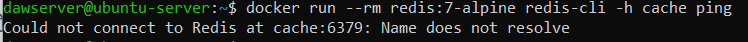
La red bridge por defecto no tiene DNS interno, por lo que el nombre cache no se resuelve y falla; con la IP sí conecta porque el tráfico se enruta directamente por IP 。
2. Crea una red propia, red-cache, y un nuevo contenedor de Redis conectado a ella.

Comprueba que un contenedor temporal en esa red lo alcanza por nombre.
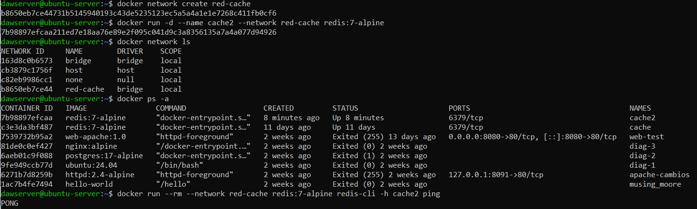
3. Guarda un valor con redis-cli -h NOMBRE set curso daw y recuperalo con get curso desde otro contenedor temporal. ¿Donde esta guardado el valor?
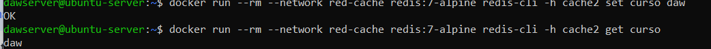
El valor se guarda en el directorio de datos de Redis dentro del contenedor cache2 (capa escribible). Si se elimina el contenedor, el dato se pierde salvo que se monte un volumen.
4. Explica por que en la configuracion de una aplicacion se usan nombres de contenedor y no direcciones IP, y por que para todo esto no ha hecho falta publicar ningun puerto.
    - La IP cambia al recrear el contenedor; el nombre no, y el DNS de la red propia lo resuelve siempre a la IP actual .

    - Los contenedores de la misma red propia se comunican por el puerto interno (6379 de Redis) sin necesidad de publicarlo al host, por eso -p no es necesario.
5. Elimina los contenedores y la red creada. ¿Que ocurre con los datos guardados en Redis?
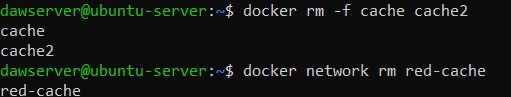
Los datos de Redis se pierden al eliminar el contenedor (no había volumen).

## Actividad 1.2: aislamiento entre redes

Simula una arquitectura con una red frontal y una red de datos:

1. Crea las redes frontal y datos. Crea un contenedor Redis llamado cache en la red datos, y un contenedor llamado api en la red frontal que se quede en marcha (por ejemplo, docker run -d --name api --network frontal redis:7-alpine sleep 3600, que usa la imagen de Redis solo por su cliente).
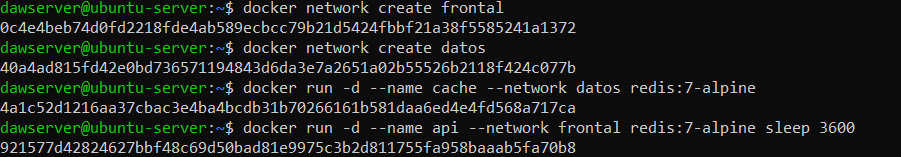
2. Demuestra con docker exec api redis-cli -h cache ping que api no alcanza a cache.
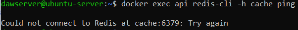
3. Conecta api tambien a la red datos y repite la prueba.
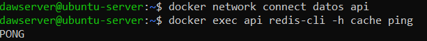
4. Comprueba que un contenedor temporal en la red frontal sigue sin alcanzar cache.
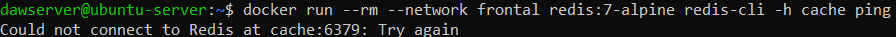
Explica que ventaja de seguridad tiene esta arquitectura.

Los contenedores de frontal no pueden acceder directamente a la base de datos de datos; solo api, que está conectado explícitamente a datos, puede hacerlo. Esto segmenta la red y reduce la superficie de ataque.

## Actividad 1.3: persistencia de una base de datos

1. Crea una red red-pg y un volumen con nombre. Despliega un contenedor pg de postgres:17-alpine en esa red, con el volumen montado en la carpeta de datos de PostgreSQL (buscala en la documentacion de la imagen) y la contraseña del administrador en POSTGRES_PASSWORD.
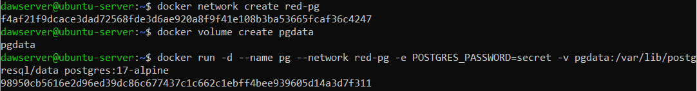
2. Conectate con docker exec -it pg psql -U postgres y crea una base de datos biblioteca con una tabla libros y al menos tres registros.
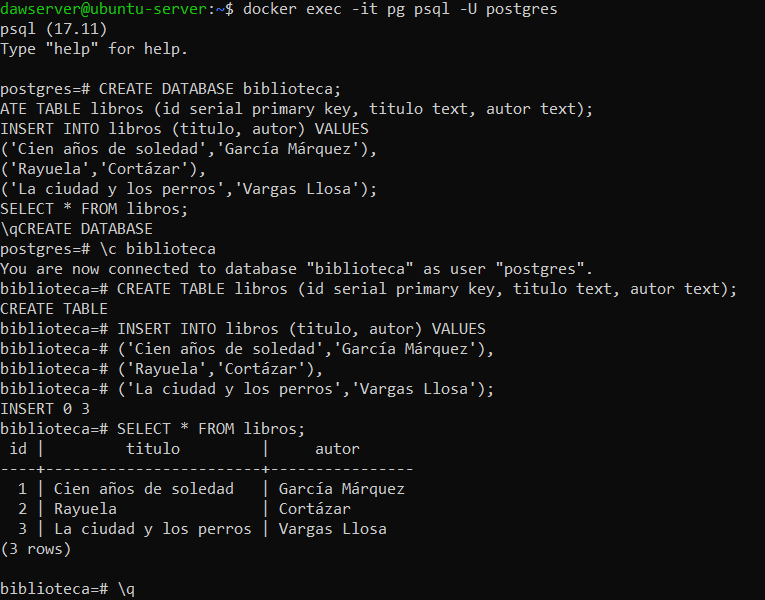
3. Elimina el contenedor, crea uno nuevo con el mismo volumen y demuestra que los datos se conservan.
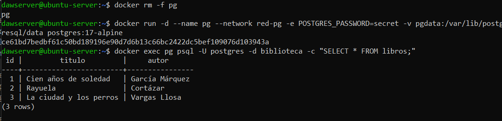
4. Desde un contenedor temporal de postgres:17-alpine en red-pg, conectate al servidor por red con psql -h pg -U postgres y comprueba que pide la contraseña.
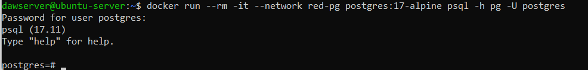
Evidencia: ordenes ejecutadas, salida de las consultas antes y despues de recrear el contenedor, salida de docker volume ls y respuestas.

## Actividad 1.4: bind mount para desarrollo

1. Sirve con un contenedor de httpd:2.4-alpine la carpeta web-apache de la actividad 2.1 del boletin anterior, usando un bind mount. Comprueba con curl que responde y que contenido muestra.
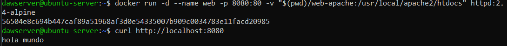
2. Modifica la pagina en el host y demuestra que el cambio se ve sin reconstruir ni reiniciar nada.

3. Intenta crear un archivo en esa carpeta desde dentro del contenedor con docker exec.
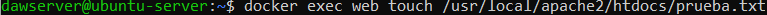
¿Que ocurre y por que?
Docker Compose
Qué ocurre: normalmente devuelve Permission denied por motivos como permisos del host o el propietario

## Actividad 2.1: un proyecto Compose con imagenes de Docker Hub: WordPress con MariaDB

Despliega con Compose un sitio WordPress, el gestor de contenidos mas usado en la web, con su base de datos MariaDB. Consulta en Docker Hub las variables de entorno de las imagenes wordpress y mariadb. El compose.yaml debe cumplir estos requisitos:

Dos servicios: wp (imagen wordpress:6) y db (imagen mariadb:11).

Solo wp publica un puerto, en 127.0.0.1:8080.

La base de datos usa un usuario propio para WordPress, no el administrador.

Todas las contraseñas se toman de un archivo .env, que no se sube al repositorio; en su lugar se sube .env.example.

Los datos de MariaDB y los archivos de WordPress (/var/www/html) se guardan en volumenes con nombre.

db tiene una comprobacion de salud (la imagen incluye el script healthcheck.sh; consulta su uso en la documentacion) y wp no arranca hasta que db esta sano.

Ambos servicios tienen una politica de reinicio.

Tareas:

1. Escribe el compose.yaml, validalo con docker compose config y levanta el proyecto.

Comprueba con docker compose ps el estado de salud de db y con docker network ls y docker volume ls que recursos ha creado Compose y con que nombres.
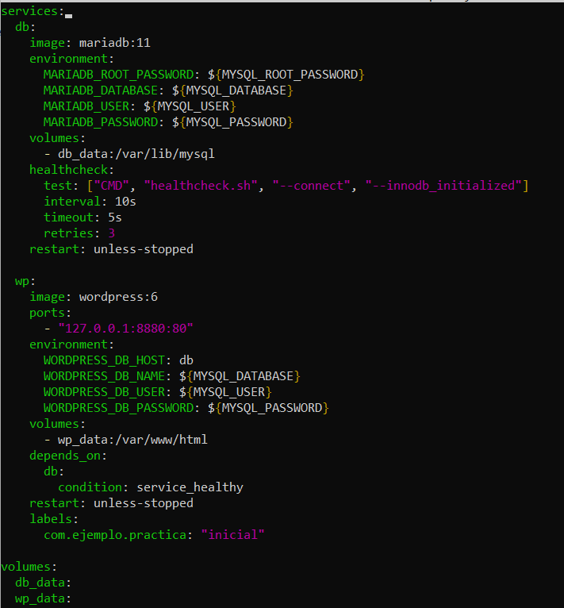
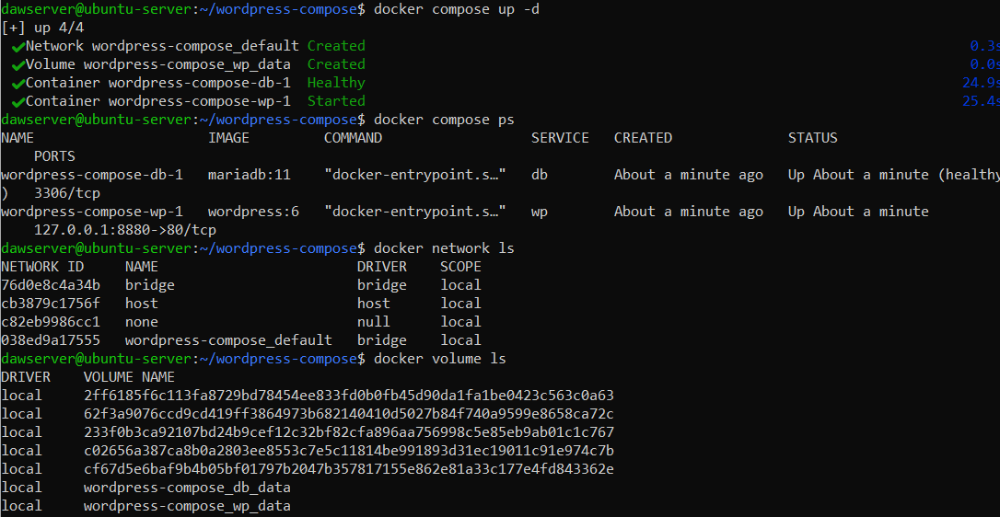
2. Completa la instalacion de WordPress desde el navegador del anfitrion (con un tunel SSH al puerto 8080 si lo haces desde la VM).
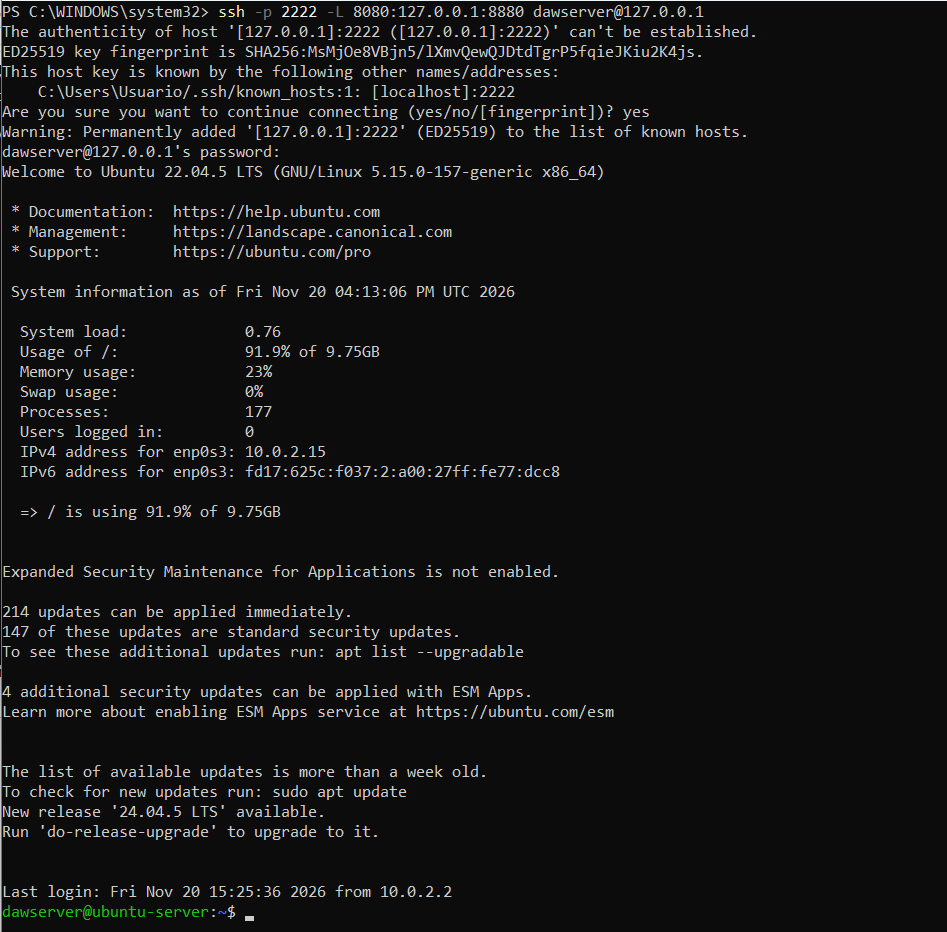
3. Ejecuta docker compose up -d dos veces seguidas sin cambios. Despues, cambia algo de la configuracion de wp. Por ejemplo, añade un label:

labels:

com.ejemplo.practica: "actualizada"

(labels es un diccionario de metadatos que no afecta al funcionamiento del contenedor. Se utilizan para añadir informacion adicional al contenedor, como tags o atributos de identificacion, que permiten organizar y filtrar los contenedores, o que otras herramientas lean informacion del contenedor).

Ejecuta de nuevo docker compose up -d y explica que hace Compose en cada caso.
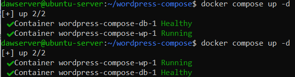
4. Crea una entrada en WordPress y muestra la captura de pantalla (accede a Posts → Add Post). Explica que ocurre con la entrada si eliminas el contenedor wp y lo recreas con docker compose up -d.
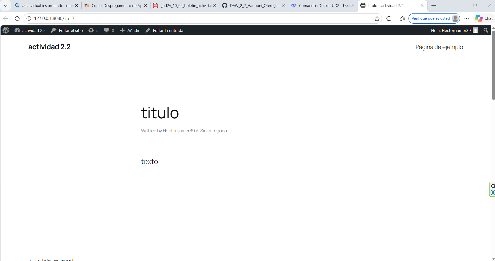
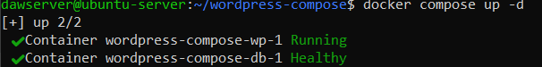
5. Demuestra que la entrada sobrevive a docker compose down y que se pierde con docker compose down -v.
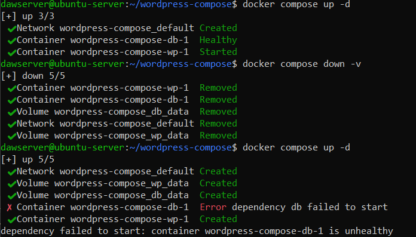
6. Renombra .env temporalmente y muestra el error que se obtiene al validar el proyecto.
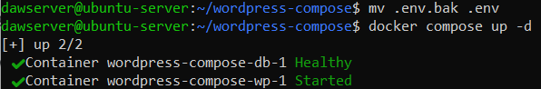

## Actividad 2.2: un proyecto para construir la imagen con Compose

1. Crea un segundo proyecto Compose para la aplicacion saludo de la actividad 4.1, que construya la imagen con build:, tome MENSAJE de un archivo .env y tenga una comprobacion de salud sobre la ruta /salud (la imagen node:24-alpine incluye wget).
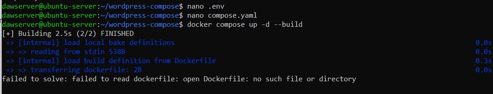
2. Modifica app.js (por ejemplo, cambia el header de nivel 1 a nivel 2), aplica el cambio y muestra en la salida que Compose reconstruye la imagen y recrea el servicio.
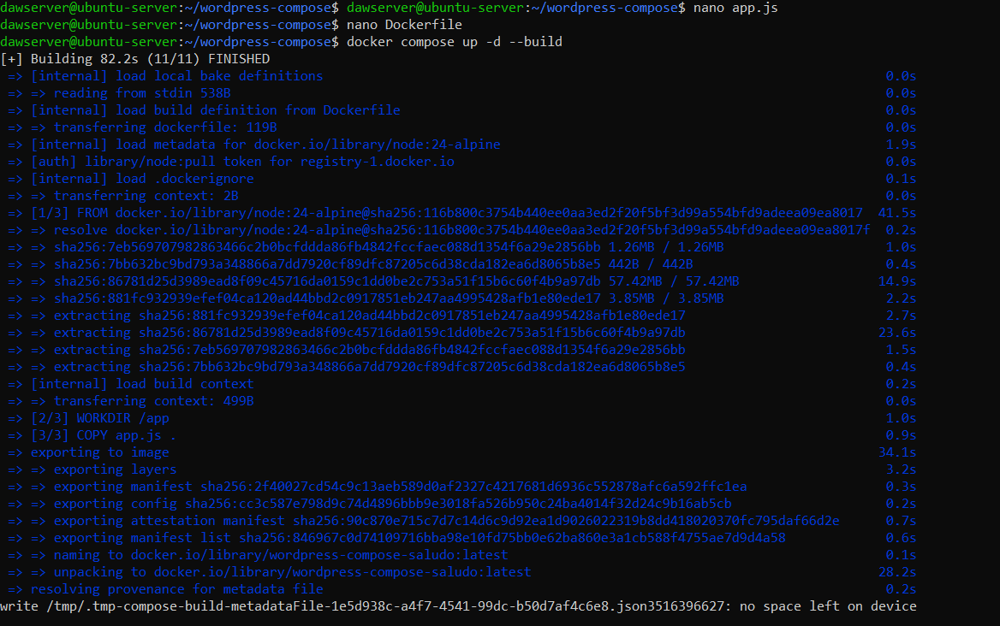
